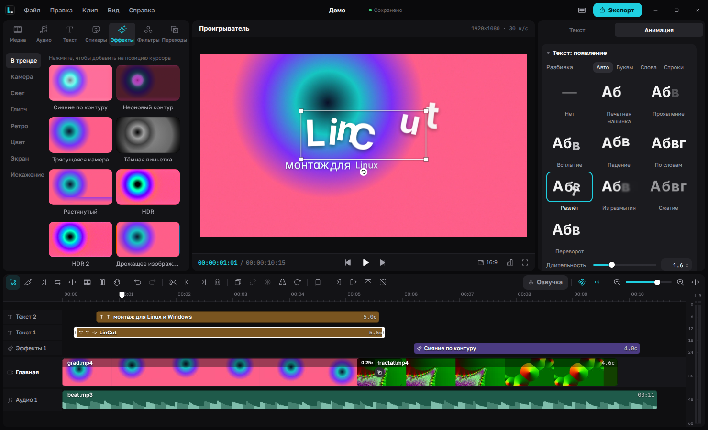
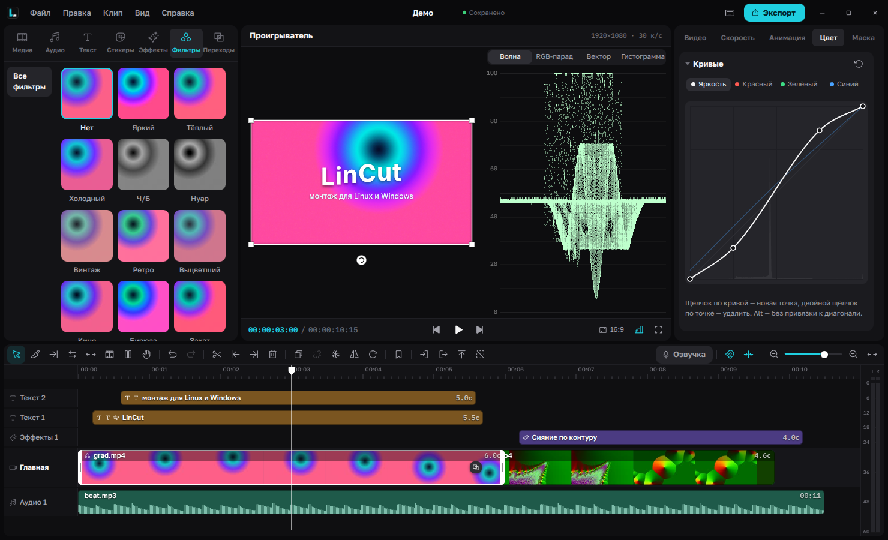
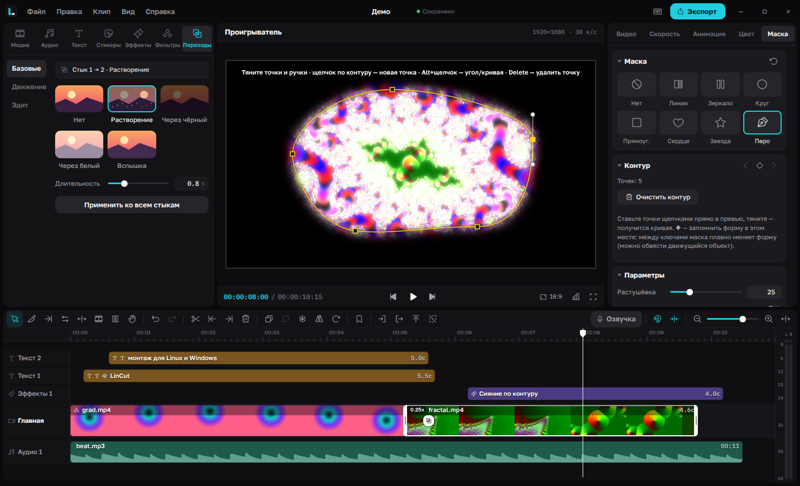
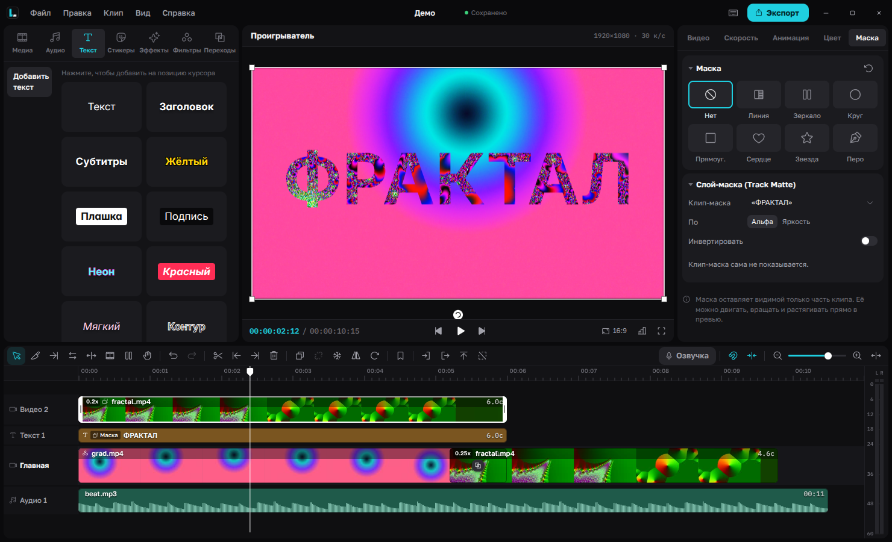

# LinCut

Видеоредактор для Linux и Windows с интерфейсом в стиле CapCut. Electron + FFmpeg.



<table>
  <tr>
    <td></td>
    <td></td>
  </tr>
  <tr>
    <td align="center">Кривые, фильтры и видеоскопы</td>
    <td align="center">Маска пером с анимацией формы</td>
  </tr>
  <tr>
    <td colspan="2" align="center"><br>Track Matte — видео внутри текста</td>
  </tr>
</table>

**[⬇ Скачать для Windows](https://github.com/Flenstick/lincut/releases/latest)**

## Запуск

**Arch Linux** (и Manjaro, EndeavourOS, CachyOS…) — установка и обновление одной командой:

```bash
curl -fsSL https://raw.githubusercontent.com/Flenstick/lincut/main/packaging/arch/install.sh | sh
```

Скрипт скачивает пакет последнего релиза и ставит его через pacman — `electron43` и `ffmpeg` подтянутся сами.
Потом — `lincut` или «LinCut» в меню приложений. Чтобы обновить, запустите ту же команду; удалить — `sudo pacman -R lincut`.
PKGBUILD — в [`packaging/arch`](packaging/arch).

**Linux из исходников:**

```bash
lincut            # или ./lincut.sh, или «LinCut» в меню приложений
```

Нужны `electron`, `ffmpeg`, `ffprobe`; для импорта по ссылке — `yt-dlp`, для нейросетей — `uv`.

**Windows:** установщик `LinCut-Setup-*.exe` (или архив `LinCut-*-win-x64.zip`) со [страницы релизов](https://github.com/Flenstick/lincut/releases).
Установщик не подписан — при первом запуске SmartScreen предложит «Подробнее → Выполнить в любом случае».
ffmpeg, yt-dlp и uv уже внутри — ставить ничего не нужно. Начиная с 1.1.0 LinCut **обновляется сам**: новая версия
скачивается в фоне, в шапке появляется кнопка «Обновить до …» (или обновление ставится само при выходе).
Версию 1.0.0 нужно один раз заменить на 1.1.0 вручную.

**Замена текста на кадре** — выделите картинку или видео, нажмите «Заменить текст…» (вкладка клипа, раздел «Текст на кадре») и обведите рамкой нужную надпись или слово (или «Весь кадр»):
нейросеть найдёт надписи (русский и английский), подберёт тот же шрифт из установленных, цвет и размер, сотрёт старый текст
и вставит новый обычным текстовым клипом. На видео текст стирается на каждом кадре, а новый едет за местом старого.

**Нейросети** («Голос и фон», трекинг, «Вырезать объект», замена текста) — «Файл → Нейросети» (или «Нейросети» на главном экране):
кнопка «Загрузить все» скачивает всё сразу (≈ 3,5 ГБ) с прогрессом, скоростью и оставшимся временем; иначе каждая
загрузится при первом использовании. Ставятся в `%LOCALAPPDATA%\LinCut` (Linux — `~/.local/share/lincut`),
PyTorch — под установленную видеокарту NVIDIA (без неё — версия для процессора).

## Сборка для Windows (на Linux)

```bash
npm install                 # electron-builder
npm run fetch:win           # ffmpeg/ffprobe (BtbN, GPL), yt-dlp.exe, uv.exe → vendor/win
npm run dist:win            # dist/LinCut-Setup-*.exe и dist/LinCut-*-win-x64.zip (нужен wine — для иконки exe)
```

Релиз для автообновления: поднять `version` в package.json, собрать и выложить в релиз GitHub `v<версия>`
**все** файлы: `LinCut-Setup-*.exe`, `LinCut-Setup-*.exe.blockmap`, `latest.yml` (по нему программы узнают о новой версии) и zip.

## Возможности

- Проекты с автосохранением (`~/Видео/LinCut`), главный экран со списком проектов
- Импорт видео / фото / аудио (кнопка или перетаскивание из файлового менеджера)
- Таймлайн: главная дорожка с авто-склейкой, наложения, текст, аудио; миниатюры и волны
- Обрезка краёв, разрезание (Ctrl+B), удаление слева/справа (Q/W), привязка, зум
- Запись озвучки с микрофона поверх видео (R)
- Изменение голоса: Спрингтрап, робот, демон, бурундук, рация и др. — для озвучки и любого звука
- Текст с пресетами, шрифтами, обводкой, фоном, тенью; эмодзи-стикеры
- Фильтры, цветокоррекция, размытие, отражение, поворот, масштаб, прозрачность
- Скорость 0.1×–10× с сохранением высоты звука, громкость, нарастание/затухание
- 76 эффектов (в тренде, камера, свет, глитч, ретро, цвет, разделение экрана, искажения) с настройкой силы и скорости;
  во вкладке «В тренде» — как в CapCut: сияние и неон по контуру, HDR, круговое/радиальное размытие, трясущаяся камера,
  желейное, растянутый, «Ошибка», «Конец игры», Betamax, молния, а также занавес («Время показа») и взрыв, отрендеренные в Blender
- 19 переходов: базовые, сдвиги/рывки и «эдит»-переходы (наезд, вращение, вихрь, глитч, RGB, тряска, размытие, пиксели, вспышка)
- Анимации появления/исчезновения
- Отделение аудио, стоп-кадр, дублирование, копирование/вставка, отмена/повтор
- Соотношения сторон 16:9, 9:16, 1:1, 4:3 и др.
- Экспорт MP4/MOV (H.264/HEVC) 480p–4K, 24–60 к/с, или только аудио (MP3/WAV/FLAC); весь таймлайн или от входа до выхода
- Как в Premiere Pro: инструменты (лезвие, обрезка со сдвигом, сдвиг склейки, растяжение скорости, сдвиг содержимого и клипа, рука),
  точки входа/выхода с Lift/Extract, удаление со сдвигом всех дорожек, отключение клипов, J/K/L, «Скорость и длительность»,
  кривые RGB как в Lumetri, видеоскопы (волна, RGB-парад, вектороскоп, гистограмма), индикатор громкости,
  раскладка горячих клавиш Premiere Pro (Справка → Раскладка)

Превью и экспорт используют одни и те же формулы (цвет — через 3D LUT), поэтому
результат совпадает с тем, что видно в проигрывателе.

Форматы, которые Chromium не умеет показывать (например HEVC), автоматически
получают прокси-файл для превью; экспорт всегда идёт из оригинала.

## Как устроены эффекты

Эффект — это набор операций (камера, уровни, цветовая матрица, размытие, RGB-сдвиг, свечение,
текстуры, раскладка экрана, шлейф, искажения). Параметры анимируются выражениями от времени,
которые одинаково вычисляются в превью (canvas) и в ffmpeg (`sendcmd`, `perspective`), поэтому
экспорт совпадает с тем, что видно в проигрывателе. См. `src/js/effects.js`.

Операции, которым нужен доступ к пикселям (HDR — локальный контраст, контуры — собель как в ffmpeg,
шум, искажения), в превью считаются попиксельно по тем же формулам, что и фильтры ffmpeg
(`blend=all_expr`, `sobel`, `noise`, `remap`). Анимированные искажения и наложения кадров в экспорте
подаются списком concat «картинка на каждый кадр». Готовые кадры из Blender лежат в `src/fx/<набор>/`
(WebP, `blank.webp` — пустой кадр); сцены для пересборки — `tools/blender/`.

## Лицензии

Код — MIT (см. `LICENSE`). Шрифты Inter, Golos Text, IBM Plex Mono — SIL OFL 1.1 (`src/fonts`),
иконки — Phosphor Icons (MIT). В Windows-сборку входят ffmpeg/ffprobe (BtbN, GPL), yt-dlp (Unlicense) и uv (MIT/Apache-2.0).

## Плагины

LinCut можно расширять плагинами на JavaScript: свои эффекты, фильтры, переходы, голоса, панели, команды и горячие клавиши. Меню **Плагины** → «Создать плагин…» / «Установить плагин…». Документация — [docs/plugins.md](docs/plugins.md), примеры — [examples/plugins](examples/plugins).
